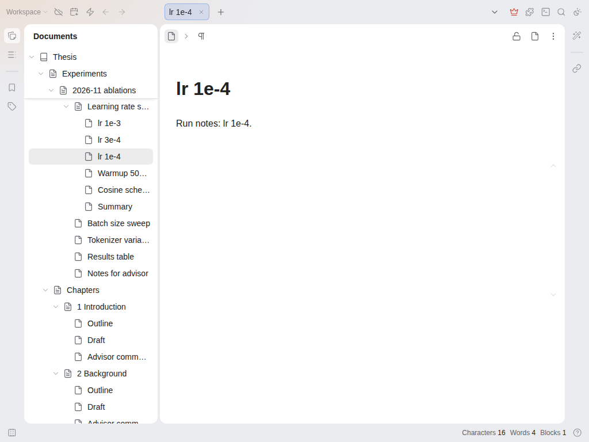

# Sticky Doc Tree

In a long document tree you scroll down into a folder and lose track of where you are: the notebook and the parent
documents have scrolled away. This plugin keeps them pinned at the top of the tree while you scroll, the way VS Code
does with sticky scroll.

- The pinned rows are the notebook and every parent of the first document you can see. They change as you scroll
  into the next folder, and the last one slides away when its folder ends.
- They behave like the real rows: click a name to open that document, click the arrow to collapse the folder,
  right-click for the usual document menu.
- Works with light and dark themes.

## Settings

- Rows to keep at the top: 1 to 10, default 6. Deeper parents scroll away as usual.

## Limits

Desktop and browser only; the mobile document tree is left alone. It draws copies of the rows over the top of the
tree and does not change SiYuan's own tree, so turning the plugin off removes it completely. Tested on SiYuan 3.8.9
(Linux, browser front end).

Requested in [siyuan-note/siyuan#16349](https://github.com/siyuan-note/siyuan/issues/16349).

## Licence

MIT. Source: <https://github.com/prometheus-maker/siyuan-sticky-doc-tree>. Problems and ideas: open an issue there.
