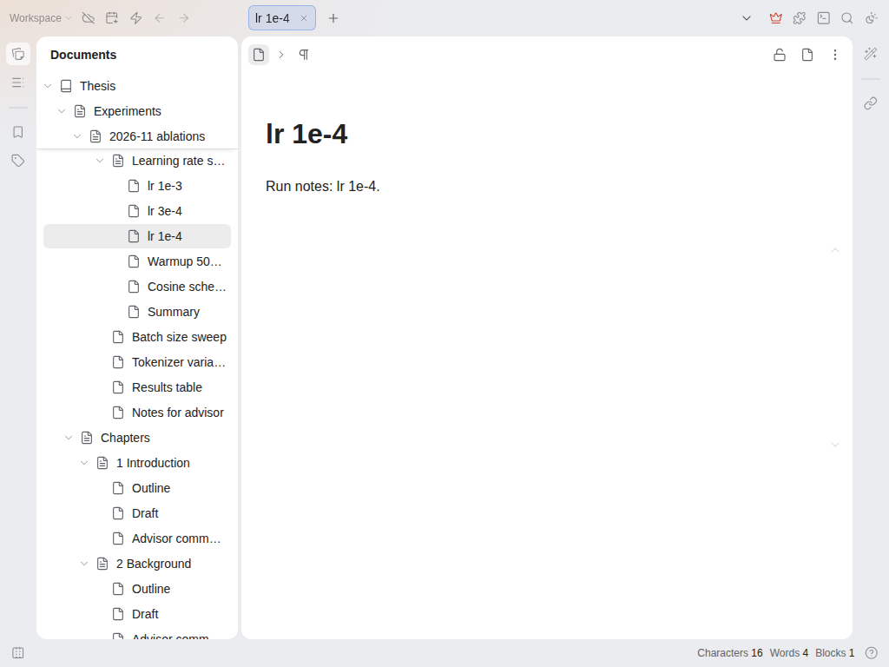

# 文档树吸顶路径

文档树很长时，滚动到某个文件夹深处，笔记本和上级文档已经滚出视野，很容易不知道自己在哪里。这个插件在滚动时把它们固定在文档树顶部，效果类似 VS Code 的粘性滚动（sticky scroll）。

- 固定的行是笔记本以及当前可见的第一个文档的所有上级。滚动进入下一个文件夹时会随之切换，某个文件夹结束时，最后一行会被平滑推走。
- 固定的行和真实的行用法相同：点击名称打开文档，点击箭头折叠文件夹，右键打开文档菜单。
- 适配浅色和深色主题。

## 设置

- 顶部保留的行数：1 到 10，默认 6。更深的上级照常滚动。

## 限制

仅支持桌面端和浏览器端，不影响移动端的文档树。插件只是在文档树上方绘制行的副本，不修改思源自身的文档树，关闭插件即可完全移除。已在思源 3.8.9（Linux，浏览器端）上测试。

需求来自 [siyuan-note/siyuan#16349](https://github.com/siyuan-note/siyuan/issues/16349)。

## 许可证

MIT。源码：<https://github.com/prometheus-maker/siyuan-sticky-doc-tree>。问题和建议请在那里提 issue。
